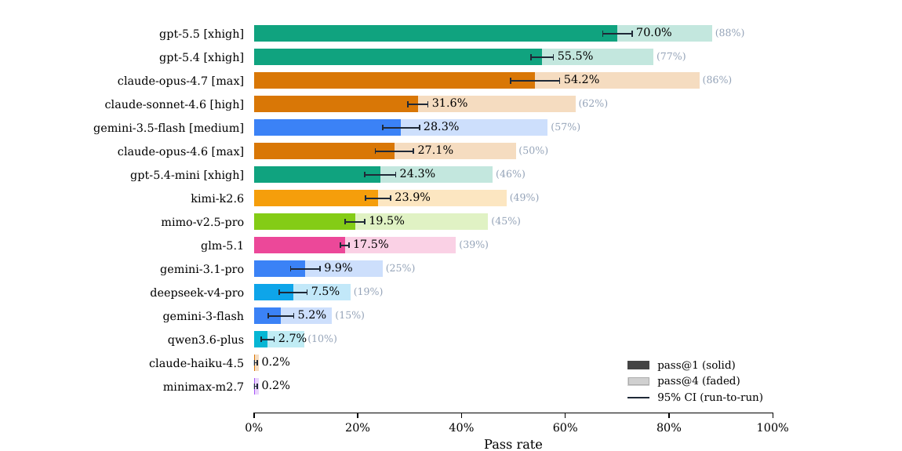
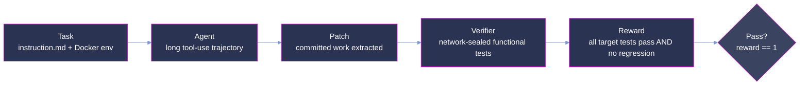

<p align="center">
  
</p>

<p align="center">
  <strong>Trajectory-first evaluation of coding agents on original, long-horizon software-engineering tasks.</strong>
</p>

<p align="center">
  <a href="#summary"></a>
  <a href="#the-benchmark"></a>
  <a href="#scoring-methodology"></a>
  <a href="#verification-and-quality-assurance"></a>
</p>

<p align="center"><sub>
  <a href="#summary">Summary</a> · <a href="#repository-layout">Layout</a> · <a href="#the-benchmark">Benchmark</a> · <a href="#difficulty-and-hardness">Hardness</a> · <a href="#results">Results</a> · <a href="#dataset-structure">Dataset</a> · <a href="#trajectory-structure">Trajectories</a> · <a href="#scoring-methodology">Scoring</a> · <a href="#reproduction">Reproduction</a> · <a href="#verification-and-quality-assurance">Verification</a>
</sub></p>

# Mikasa: Evaluation Sample

**Mikasa measures whether a coding agent can complete original, long-horizon engineering tasks
inside a real repository, and it grades the whole trajectory, not just the final diff.**
It is built on the **DeepSWE** benchmark (Huang, Lee, Tng, and Ge, Datacurve, arXiv:2607.07946):
113 tasks authored from scratch across 91 active open-source repositories in five languages, each
graded by a hand-written functional verifier that accepts any implementation providing the requested
behavior. Where SWE-bench-style benchmarks mine merged pull requests, so a high score can reflect
recall of a fix already in the training data, DeepSWE tasks are never merged upstream and their
reference solutions stay off the public record.

This repository is a **quality-controlled sample** of the Mikasa corpus, provided for evaluation.
Each task is a self-contained, containerized issue-resolution problem in the Harbor task format, and
will be paired with the complete agent trajectories of Claude Opus 4.8 recorded through the Pier
harness. The dataset format, trajectory format, and scoring are identical to the production
pipeline.

> **Measured, never claimed.** No pass rate appears in this document without a signed trajectory
> behind it. The [Results](#results) section is intentionally empty until the Opus 4.8 runs are
> recorded and verified into `trajectories/`; the tasks, format, and methodology below are complete
> and final.

## Summary

| Property             | Value                                                                          |
| :------------------- | :----------------------------------------------------------------------------- |
| Sample tasks         | **1** (`expr-structured-error-values`); corpus target **30**                    |
| Benchmark            | DeepSWE (arXiv:2607.07946), 113 tasks / 91 repositories                          |
| Task authoring       | Original, authored from scratch, never merged upstream                          |
| Model evaluated      | Claude Opus 4.8 (trajectories pending)                                           |
| Score                | binary functional reward in {0, 1}, per run in `result.json`                    |
| Verifier             | hand-written, behavior-grading, network-sealed (`network_mode = "no-network"`)  |
| Languages (corpus)   | TypeScript, Go, Python, Rust, JavaScript                                         |

**Pass rates on this sample:** _pending._ They populate here only when signed Opus 4.8 trajectories
land in `trajectories/`; see [Results](#results) and [Verification](#verification-and-quality-assurance).

## Repository layout

```
mikasa-samples/
├── README.md                 # this document
├── assets/                   # figures
│   ├── hero.jpeg
│   └── deepswe-leaderboard.png
├── dataset/                  # task definitions, one directory per UUID
│   └── <uuid>/ ...
└── trajectories/             # model runs, one directory per UUID (pending)
    └── <uuid>/<model>/run_N/ ...   # model = claude-opus-4-8
```

Task UUIDs match **1:1** between `dataset/` and `trajectories/`. Under each task, the evaluated model
appears as a `<model>/` directory, each containing one or more `run_N/` samples.

## The benchmark

Mikasa evaluates agents on the DeepSWE corpus. The properties below are DeepSWE's, per Huang et al.,
sections 3 and 4:

| Property             | Value                                                                    |
| :------------------- | :----------------------------------------------------------------------- |
| Tasks                | 113                                                                       |
| Repositories         | 91, median repository contributes 1 task                                 |
| Languages            | TypeScript, Go, Python, JavaScript, Rust                                  |
| Repository selection | public, actively maintained, permissive license                          |
| Reproducibility      | each task pinned to an immutable commit hash                             |
| Regression check     | the verifier also runs a selection of the repository's existing tests    |
| Container            | shallow clone at the base commit, no `.git` history in the sandbox      |

DeepSWE separates frontier agents across a wide score band. On the published leaderboard the strongest
Claude configuration at the time of the paper, `claude-opus-4.7 [max]`, solves 54.2% of tasks at
pass@1. This is the prior-art baseline the Mikasa tasks are authored to escalate beyond, against the
newer Claude Opus class.

<p align="center">
  
</p>
<p align="center"><sub>DeepSWE leaderboard (prior art), Figure 1 of arXiv:2607.07946. Shown for context; not a Mikasa result.</sub></p>

## Difficulty and hardness

Mikasa tasks are authored against a standing **hardness contract**: a catalog of candidate levers,
each carrying a difficulty axis, a grading mode, and, where one exists, a published anchor naming the
benchmark and cohort it was measured against. The contract is the single source of truth for what
"hard" means, and it is deliberately conservative: a lever counts as real difficulty only once a
signed pilot over frozen task bytes shows the current frontier still fails it. A task that meets every
authored target with no pilot behind it is recorded as **unproven, never hard**.

The sample task realizes six instrument-bound levers across the reasoning and agentic axes:

| Lever                  | Category      | Axis      | Anchor                                             |
| :--------------------- | :------------ | :-------- | :------------------------------------------------- |
| novelty (unmerged)     | novelty       | reasoning | DeepSWE, opus-4.7 54.2% pass@1 (arXiv:2607.07946)  |
| horizon statefulness   | horizon       | agentic   | DeepSWE, opus-4.7 54.2% pass@1                      |
| solution scale         | scale         | agentic   | DeepSWE, opus-4.7 54.2% pass@1                      |
| behavioral verifier    | grading       | reasoning | DeepSWE, opus-4.7 54.2% pass@1                      |
| shortcut stripping     | anti-shortcut | reasoning | adversarial ShortcutScore gate                     |
| domain-expertise depth | expertise     | reasoning | repository-idiomatic internals                     |

Difficulty **tiers** for this sample are computed from observed model outcomes, exactly as they are in
production, so they describe what Opus 4.8 actually experienced rather than any property fixed in
advance. They populate once trajectories land.

## Results

> **No measured evidence yet.**
>
> Mikasa's pass rate, per-task scores, and cost figures populate here only when signed Claude Opus 4.8
> trajectories are recorded into `trajectories/` and verified. Until then this section is deliberately
> empty. Publishing an unmeasured number would violate the one rule the whole pipeline is built on.
>
> The prior-art baseline on the underlying corpus is the DeepSWE leaderboard above
> (`claude-opus-4.7 [max]`, 54.2% pass@1); Mikasa tasks are authored to sit below that band for the
> newer Opus class.

## Dataset structure

Each task lives under `dataset/<uuid>/` and is fully self-contained in the Harbor task format:

```
dataset/<uuid>/
├── task.toml                 # metadata, resource limits, and network policy
├── instruction.md            # the prompt presented to the agent
├── pre_artifacts.sh          # captures the agent's committed work as a patch
├── environment/
│   └── Dockerfile            # builds the repository at its base commit
├── solution/
│   ├── solution.patch        # the reference ("oracle") source patch
│   └── solve.sh              # applies and commits the oracle patch
└── tests/
    ├── config.json           # the canonical target and preserve test lists
    ├── grader.py             # the grading logic
    ├── test.patch            # the held-out grading tests, applied before scoring
    └── test.sh               # the verifier entry point
```

During a run the agent sees only the built repository, `instruction.md`, and the environment.
`solution/` and `tests/` are used exclusively by the verifier and are never exposed to the agent. The
**target** tests the agent must newly pass are the fail-to-pass ids in `tests/config.json`; the
**preserve set** that must not regress is the large body of already-passing tests
(`p2p_node_ids`). For the sample task these are 30 target tests over 66,265 preserve tests.

## Trajectory structure

Each run lives under `trajectories/<uuid>/<model>/run_N/` and follows the Pier / augmented ATIF v1.7
format:

```
trajectories/<uuid>/<model>/run_N/        # model = claude-opus-4-8
├── result.json            # config, agent metrics, verifier reward + diagnostics
├── config.json            # the run configuration
├── agent/
│   ├── trajectory.json     # structured step-by-step trace, one step per API turn
│   ├── recording.cast      # asciinema terminal recording
│   └── opus.pane           # terminal pane snapshot
├── artifacts/manifest.json
└── verifier/
    ├── reward.json         # structured reward (binary reward + pass fractions)
    ├── ctrf.json           # machine-readable test report
    └── test-stdout.txt     # raw suite output and failure reasons
```

The authoritative model id is `config.agent.model_name` (`claude-opus-4-8`). ATIF v1.7 records one
step per API turn with strict reasoning-versus-agent-message separation, no fabricated assistant text,
`peak_context_tokens`, `summarization_count`, `llm_call_count`, and real upstream timestamps.

## Scoring methodology



The verifier computes a binary functional reward per run:

```
reward = 1  iff  |target| > 0  AND  every target test passes  AND  every preserve test still passes
```

- **Target tests** (`f2p_node_ids`) are the behavioral tests the reference solution flips to passing;
  they define the requested functionality.
- **Preserve tests** (`p2p_node_ids`) are the repository's existing tests that must not regress.

A run solves a task only when reward is exactly 1. The verifier runs **network-sealed**
(`task.toml [verifier].network_mode = "no-network"`, `environment_mode = "separate"`) so the reference
solution cannot influence a run, and grades in a pristine container after the agent's committed work is
extracted by `pre_artifacts.sh`. Two metrics are reported once runs land:

- **pass@1** — the per-task pass rate, every task weighted equally.
- **pass@4** — the fraction of tasks solved by at least one of up to four rollouts.

Every task ships a reference patch at `solution/solution.patch` that passes all target tests and scores
reward 1 by construction: the target tests are defined as the tests this patch flips to passing. This
guarantees the grading harness is self-consistent; it is **not** an independent measure of real-world
solvability.

## Reproduction

Image-building, agent execution, and scoring are orchestrated by the **Pier** harness (Harbor-compatible).

```bash
uv tool install datacurve-pier
export ANTHROPIC_API_KEY=...

# run the sample task with Claude Opus 4.8
pier run -p dataset/<uuid> --agent claude-code --model anthropic/claude-opus-4-8

# inspect a recorded trajectory
pier view trajectories/<uuid>/claude-opus-4-8/run_1
```

Once trajectories land, the reward and full diagnostics for every run are in
`trajectories/<uuid>/<model>/run_N/result.json`, with the bare reward in `verifier/reward.json`. Pass
rates recompute directly from those files with no re-execution.

## Verification and quality assurance

Every task in this sample passes a QC gate before delivery, enforced by the Trinity governance
pipeline (author, audit, remember) that stands behind Mikasa:

- **Functional feasibility.** The reference solution scores reward 1 through the real harness, proven
  across 5 independent container runs with byte-identical scores. The unmodified base grades green on
  all preserve tests (baseline cleanliness).
- **Strictly harder than its source.** The sample task is a solution-centric evolution of a DeepSWE
  parent; the parent's own reference solution **fails** the child verifier, so the child demands more
  than the task it was grown from.
- **Reward-hacking resistance.** An adversarial pass (Hacker / Fixer / Solver plus a ShortcutScore
  taxonomy gate) found no way to score reward 1 without genuinely implementing the feature. All five
  shortcut classes (lexical, negation, positional, style-cue, hardcode-table) are resistant. Editing
  the graded tests or reading `.git` history for the reference is a red-line that zeroes the run.
- **Private boundary.** The agent is never given the reference solution (`solution/`) or the grading
  tests (`tests/`); a canary tripwire and a paraphrase-containment control confirm no private byte
  leaks into the agent-visible package.
- **Difficulty is measured, never claimed.** Task difficulty is unproven until an external, signed
  pilot over frozen task bytes shows the current Claude Opus class fails it. This sample ships its
  tasks and format; the signed difficulty evidence and the trajectories follow.
- **Limitations.**
  - **Sample size.** This is a single-task sample of a corpus targeting 30 tasks; it demonstrates the
    format and the QC gate, not a distribution.
  - **Contamination.** Tasks are authored from scratch and never merged upstream, which is the primary
    contamination defense; whether any upstream repository appeared in a model's training data is a
    separate question addressed per task by a recorded provenance date.
  - **Model nondeterminism.** The same model can produce different outputs for the same task, so
    per-run results vary.
